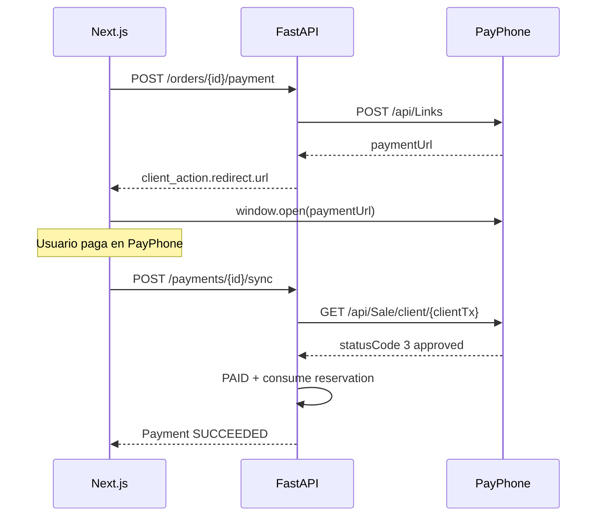

# GEMA Technology — PayPhone (Ecuador) v1

**Fecha:** 2026-10-08  
**Alcance:** Integración sandbox/producción del proveedor `payphone` vía API Link + consulta Sale + Notificación Externa opcional.

---

## 1. Por qué PayPhone

- Pasarela local Ecuador, montos en **USD** (centavos enteros).
- API Link: una sola petición POST genera un URL de cobro (sin iframe; PCI en lado PayPhone).
- Encaja con el `PaymentProvider` existente sin cambiar totales/reservas de inventario.

`manual` sigue disponible solo en development/staging/test.

---

## 2. Flujo



Confirmación de verdad: **solo el backend** (sync o webhook). La redirección del navegador no marca la orden como pagada.

---

## 3. Variables de entorno

| Variable | Uso |
|----------|-----|
| `PAYMENT_DEFAULT_PROVIDER=payphone` | Activa el provider |
| `PAYPHONE_TOKEN` | Bearer token de la app API |
| `PAYPHONE_STORE_ID` | `storeId` de Payphone Developers |
| `PAYPHONE_API_BASE` | Default `https://pay.payphonetodoesposible.com` |
| `PAYPHONE_WEBHOOK_SECRET` | Opcional; si se define, exige `?token=` o header |

En `APP_ENV=production`, Settings exige token + storeId cuando el provider es `payphone`, y rechaza `manual`.

---

## 4. Endpoints GEMA

| Método | Ruta | Rol |
|--------|------|-----|
| POST | `/api/v1/orders/{order_id}/payment` | Cliente — crea link |
| POST | `/api/v1/payments/{payment_id}/sync` | Cliente — consulta Sale y confirma |
| POST | `/api/v1/payments/webhooks/payphone` | PayPhone Notificacion Externa |
| POST | `/api/v1/payments/webhooks/payphone/NotificacionPago` | Alias (nombre pedido por PayPhone) |

Respuesta del webhook hacia PayPhone:

```json
{ "Response": true, "ErrorCode": "000" }
```

---

## 5. Probar PayPhone de verdad (sandbox)

### 5.1 Credenciales

1. Cuenta [Payphone Business](https://www.payphone.app/) + usuario con rol **Desarrollador**.
2. Entra a [Payphone Developers](https://appdeveloper.payphonetodoesposible.com/).
3. **+ Agregar** aplicación:
   - Tipo: **API** (no WEB)
   - Entorno: **PRUEBAS**
4. Pestaña **Credenciales** → copiar **Token** y **StoreID**.

### 5.2 `.env` (raíz del monorepo)

```bash
PAYMENT_DEFAULT_PROVIDER=payphone
PAYPHONE_TOKEN=...
PAYPHONE_STORE_ID=...
```

Reinicia **uvicorn** (Settings se carga al arrancar).

### 5.3 Smoke test de credenciales (sin checkout)

```bash
cd apps/api
# Windows: .venv\Scripts\activate
python -m app.scripts.check_payphone
```

Si responde `OK` e imprime un `paymentUrl`, ábrelo en el navegador y completa un pago de prueba ($1.00). En PRUEBAS las transacciones se aprueban sin cobro bancario real.

### 5.4 Flujo completo en GEMA

1. API + web en marcha (`uvicorn` + `npm run dev`).
2. Login cliente → carrito → checkout → orden `PENDING_PAYMENT`.
3. **Iniciar pago** → debe abrirse pestaña PayPhone (`provider=payphone` en Network).
4. Paga en PayPhone → vuelve a GEMA → **Ya pagué — verificar**.
5. Orden debe pasar a `PAID`.

Si el botón no abre PayPhone: en DevTools → `POST /api/v1/orders/.../payment` revisa `provider` y el mensaje de error (503 = faltan token/storeId).

### 5.5 Notificación Externa (opcional)

Requiere HTTPS público y autorización de PayPhone (3–5 días hábiles). URL:

`https://tu-dominio/api/v1/payments/webhooks/payphone/NotificacionPago`

Hasta entonces, usa **Ya pagué — verificar** (`/sync`).

---

## 6. Detalles técnicos

- `clientTransactionId` = `payment.id.hex[:15]` (máx. 15 chars; guardado en `provider_payment_id`).
- Montos en centavos. Sin IVA (`commerce_tax_enabled=false`): todo el total va en `amountWithoutTax`.
- Con IVA: base ≈ subtotal − descuento → `amountWithTax`, `tax` = `tax_total`, envío → `amountWithoutTax`.
- `oneTime=true`; `expireIn` acotado por `RESERVATION_TTL_HOURS`.
- El webhook valida `StoreId` y, si hay monto, que coincida con el pago GEMA.

---

## 7. Pruebas

```bash
cd apps/api
python -m pytest tests/test_payphone.py tests/test_payments.py -q
```

Los tests usan un cliente HTTP falso; no llaman a PayPhone real.

---

## 8. Pendiente ops

1. Cuenta PayPhone Business + app API (sandbox).
2. Activar Notificacion Externa cuando haya HTTPS público.
3. Staging: `PAYMENT_DEFAULT_PROVIDER=payphone` + secretos fuertes.
4. No embeber el link en iframe (requisito PCI / docs PayPhone).
